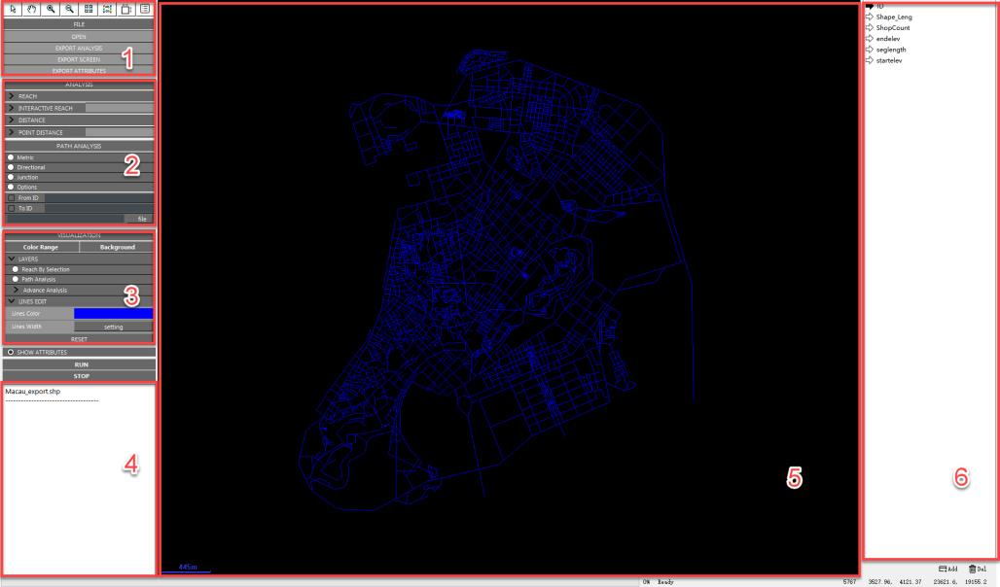

# UrConnect Documentation

UrConnect is an innovative desktop tool for spatial configuration analysis of segment-based urban street networks. Its core contribution is an UrConnect algorithm suite for reach, directional distance, junction distance, weighted accessibility, point distance, and shortest-path analysis.

```{raw} html
<div class="urconnect-hero">
  
</div>
```

## Choose A Language

```{raw} html
<div class="language-grid">
  <a href="en/installation.html"><strong>English</strong><br>Installation, getting started, and analysis guide.</a>
  <a href="zh-CN/installation.html"><strong>简体中文</strong><br>安装、快速开始和用户指南。</a>
  <a href="zh-HK/installation.html"><strong>繁體中文（香港）</strong><br>安裝、快速開始和使用指南。</a>
</div>
```

## Documentation Structure

The English, Simplified Chinese, and Traditional Chinese (Hong Kong) sections cover the same workflow, sections, and figures.

```{toctree}
:maxdepth: 2
:caption: English

en/installation
en/command-line
en/getting-started
en/user-interface
en/analysis-reach
en/analysis-distance
en/path-analysis
en/visualization-file-management
en/output-fields
en/examples
en/faq
```

```{toctree}
:maxdepth: 2
:caption: 简体中文

zh-CN/installation
zh-CN/command-line
zh-CN/getting-started
zh-CN/user-interface
zh-CN/analysis-reach
zh-CN/analysis-distance
zh-CN/path-analysis
zh-CN/visualization-file-management
zh-CN/output-fields
zh-CN/examples
zh-CN/faq
```

```{toctree}
:maxdepth: 2
:caption: 繁體中文（香港）

zh-HK/installation
zh-HK/command-line
zh-HK/getting-started
zh-HK/user-interface
zh-HK/analysis-reach
zh-HK/analysis-distance
zh-HK/path-analysis
zh-HK/visualization-file-management
zh-HK/output-fields
zh-HK/examples
zh-HK/faq
```

```{toctree}
:hidden:

zh-CN/user-guide
zh-HK/user-guide
```
